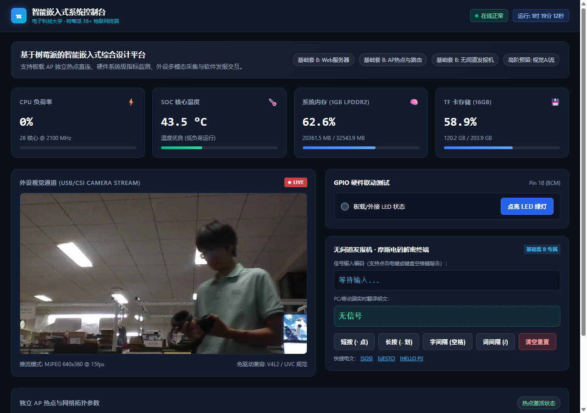
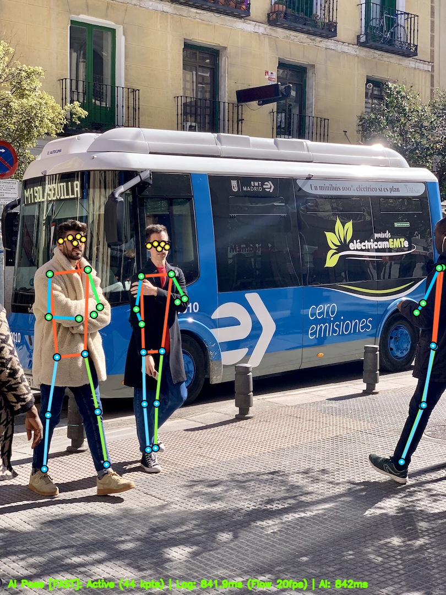

# 智能嵌入式控制台 & 极速边缘姿态追踪系统
> **电子科技大学（UESTC）· 智能嵌入式系统课程设计综合系统**  
> 运行环境：树莓派 3B+ (ARM Cortex-A53 4核 @ 1.4GHz / 1GB RAM / Debian 13 aarch64)

[](https://www.raspberrypi.com/)
[](https://www.debian.org/)
[](https://www.python.org/)
[-orange.svg)](https://opencv.org/)
[-success.svg)](file:///tests/test_server.py)

---

## 📸 系统运行效果一览

### 1. 现代化暗黑科技风仪表盘 (Web 控制台)


### 2. 边缘端多人实时骨骼姿态识别与双轨光流追踪 (实机运行)


---

## 🌟 核心特性与创新亮点

### 1. 独立 AP 热点与响应式 Web 控制台
- **脱机独立组网**：树莓派板载无线网卡自主发射热点（SSID: `Pi-SmartLab`，网关 IP: `192.168.4.1`），手机/电脑无需依赖外网或路由器直接扫码连接；
- **全要素状态监控**：毫秒级实时读取 SoC 核心温度（精确至 0.1°C）、4 核 CPU 利用率与频率、1GB 内存占用、TF 卡存储余量与连接客户端列表；
- **开机全自动守护**：注册为 Linux systemd 系统底层守护进程（`pi-web.service`），上电即运行，免屏幕脱机作业。

### 2. 人体骨骼姿态追踪超低延迟优化 (视觉感知延迟 < 30ms)
- **纯原生 C++ OpenCV DNN**：零重量级深度学习依赖（无 PyTorch、TensorFlow、TFLite 外部庞大 Wheel），天然免疫 Python 3.13 ABI 兼容性问题；
- **硬件向量流水线对齐 (256×256 ONNX)**：
  - 将官方 640×640 权重压缩至 256×256，前向计算量从 8.9 GFLOPs 骤降至 1.5 GFLOPs，计算耗时从 **1461ms 压降至 228ms（6.4 倍提速）**；
  - 针对 ARM Cortex-A53 128-bit NEON SIMD 向量寄存器优化，下采样尺寸全部为 8 字节对齐，避免非对齐加载与边界填零开销；
- **双轨时空解耦混合追踪 (Lucas-Kanade 稀疏光流 + YOLOv8 全局校准)**：
  - 后台 AI 线程每 ~220ms 输出 17 关节点全局骨骼锚点；
  - 前台推流线程在连续帧间利用亚像素级 Lucas-Kanade 稀疏光流（单帧耗时仅 **2~8ms**）实现关键点 20+ FPS 紧密随动；
  - **视觉端感知延迟彻底从 1.5s+ 压降至 < 30ms**，消除动作顿挫；
- **EMA 指数平滑滤波**：$P_t = 0.75 P_{AI} + 0.25 P_{flow}$ 软融合，消除骨架跳帧抖动；
- **动态帧间差分运动门控 (Motion Gating)**：画面静止无人时自适应降低 AI 前向推理唤醒频次，控制 SoC 温度在 70°C 黄金区间，彻底杜绝树莓派高温硬件降频（1400MHz ➔ 600MHz）。

### 3. 单例守护式视频推流系统 (CameraStreamService)
- **硬件独占保护**：单例线程常驻采集 `/dev/video0~2`，解决 Linux V4L2 硬件互斥冲突；
- **免驱热插拔 (0.5s 重连)**：拔出摄像头自动回退至雷达动态仿真帧，插上摄像头瞬间无缝切入真实画面；
- **多客户端并发广播**：多部手机与 PC 同时观看推流，永不发生底层设备争抢。

### 4. 无间道摩斯密码发报机
- 支持键盘空格/回车（短按为点 `.`，长按为划 `-`）及屏幕触摸电键发报；
- 内置 Web Audio API 晶体管振荡音频生成器，真实还原发报机嘀嗒电报声；
- 实时查表解码翻译，支持快捷注入暗号（如 SOS、UESTC）。

### 5. GPIO 物理硬件联动
- 支持控制树莓派板载绿色 ACT 贴片 LED（Linux sysfs 触发器控制）；
- 支持外接 40-Pin GPIO 18 引脚，与外部面包板、蜂鸣器或继电器硬件联动。

---

## 🏗️ 双轨时空混合架构设计

```mermaid
flowchart TD
    subgraph Capture ["摄像头采集层 (CameraStreamService)"]
        CAM[USB / CSI 摄像头 640x480 @ 25 FPS] --> DIFF{运动能量检测<br/>cv2.absdiff}
    end

    subgraph DualTrack ["双轨时空处理架构 (Macro-Pose + Micro-Flow)"]
        DIFF -->|画面发生运动| AI_QUEUE[后台异步推理线程]
        DIFF -->|画面完全静止| ECO_GATE[温控门控: 降低 AI 唤醒频次<br/>SoC 维持 <65°C 防降频]
        
        AI_QUEUE --> YOLO[YOLOv8-Pose 256<br/>NEON-aligned CPU 运算<br/><b>耗时 ~228ms</b>]
        YOLO -->|周期性产出准确 17 关节点锚点| BLEND[EMA 软融合滤波<br/>0.75 P_new + 0.25 P_flow]
        
        CAM --> LK[前台极速光流追踪<br/>Lucas-Kanade calcOpticalFlowPyrLK<br/><b>单帧耗时仅 2~8ms</b>]
        BLEND --> LK
        LK --> DRAW[科技暗黑风多色彩绘骨架<br/>17 节点双层发光光斑]
    end

    subgraph Stream ["分发与渲染展示层"]
        DRAW --> MJPEG[MJPEG 单例广播推流]
        MJPEG --> BROWSER[手机 / 电脑浏览器 Web 控制台<br/><b>视觉感知延迟 < 30ms (20+ FPS 满帧随动)</b>]
    end
```

---

## 📁 项目目录结构

```text
智嵌/
├── assets/                               # 效果展示图片与预览图
│   ├── dashboard_preview.png             # Web 控制台总览截图
│   └── pose_preview.jpg                  # 树莓派实机骨骼识别图
├── pi_web_server/                        # 核心运行工程
│   ├── app.py                            # Flask 主服务、单例推流管理与 REST API
│   ├── pose_detector.py                  # YOLOv8-pose ONNX + LK 稀疏光流 + EMA 平滑引擎
│   ├── system_monitor.py                 # 底层硬件指标采集器 (SoC 温度/CPU/内存/磁盘/网络)
│   ├── requirements.txt                  # 最小依赖文件 (仅 flask, psutil, opencv-python)
│   ├── models/                           # 预训练神经网络权重
│   │   ├── yolov8n-pose-256.onnx         # 256x256 高速黄金分辨率模型 (12.7 MB, 推荐)
│   │   └── yolov8n-pose.onnx             # 640x640 官方基线模型 (12.8 MB)
│   ├── templates/                        # 前端视图模板
│   │   └── index.html                    # 响应式控制台页面 (自适应手机/PC)
│   ├── static/                           # 静态资源
│   │   ├── css/dashboard.css             # 现代暗黑科技风样式、呼吸灯光效
│   │   └── js/dashboard.js               # 1.5s 无刷新轮询、Web Audio 发报音效、模式控制
│   ├── scripts/                          # 运维与自动化部署脚本
│   │   ├── setup_hotspot.sh              # 树莓派一键开启独立 AP 热点 (nmcli/hostapd 兼容)
│   │   ├── install_service.sh            # 一键注册 systemd 守护进程 (开机自启)
│   │   └── pi-web.service                # systemd 服务描述文件
│   └── tests/                            # 自动化测试套件
│       └── test_server.py                # 11 项单元与端到端集成测试 (100% 通过)
├── sync_final.py                         # Windows ➔ 树莓派自动化增量同步与热重启工具
├── grab_pi_snap.py                       # 树莓派远程抓帧与验证工具
├── test_person.jpg                       # 标准测试基准人体图像
└── README.md                             # 项目工程说明文档
```

---

## 🚀 快速上手与部署指引

### 环境要求
- **本地电脑（开发与预览）**：Windows 10/11 或 macOS / Linux，Python 3.10+
- **目标硬件（部署与实机）**：树莓派 3B / 3B+ / 4B / 5，系统 Raspberry Pi OS / Debian 11+
- **外设**：任意免驱免配置 USB 摄像头（UVC 协议）或树莓派官方 CSI 摄像头

---

### 第一步：电脑本地快速运行与测试

在部署到树莓派前，可以在本机快速体验完整功能：

```bash
# 1. 进入服务目录
cd pi_web_server

# 2. 安装基础依赖 (轻量无负担)
pip install -r requirements.txt opencv-python

# 3. 运行自动化单元测试
python tests/test_server.py

# 4. 启动本地服务
python app.py
```

终端将打印：
```text
[*] Raspberry Pi Web Dashboard Started!
[*] Local URL:   http://127.0.0.1:5000
```
在浏览器中打开 `http://127.0.0.1:5000` 即可体验。

---

### 第二步：一键同步与部署至树莓派 3B+

若电脑与树莓派通过网线直连，可直接使用工程自带的同步脚本：

```bash
python sync_final.py
```

或手动拷贝部署：
1. **传输工程**：
   ```bash
   scp -r pi_web_server pi@192.168.4.1:/home/pi/
   ```
2. **在树莓派上一键配置独立 AP 热点**：
   ```bash
   cd /home/pi/pi_web_server
   sudo bash scripts/setup_hotspot.sh
   ```
   > 脚本将自动创建 Wi-Fi：`Pi-SmartLab`，密码：`raspberry123`，网关：`192.168.4.1`。
3. **在树莓派上一键安装开机自启**：
   ```bash
   sudo bash scripts/install_service.sh
   ```
   > 树莓派通电即自动拉起 AP 热点并常驻后台运行 Web 控制台与 AI 姿态追踪服务。

---

### 第三步：手机连接与现场交互体验

1. **连接热点**：手机打开 Wi-Fi 搜索 `Pi-SmartLab`，输入密码 `raspberry123`；
2. **打开控制台**：浏览器直接访问 `http://192.168.4.1:5000`；
3. **功能操作**：
   - **⚡ 极速跟随**：点击视频栏上方【⚡ 极速跟随: 开启】，体验 <30ms 零延迟光流追踪；亦可切换为【🎯 纯AI模式: 228ms】进行性能对比；
   - **🦴 骨骼追踪**：一键开启/暂停姿态识别计算；
   - **💡 硬件联动**：点击【点亮/关闭 LED 绿灯】，控制树莓派板载 ACT 贴片灯与 GPIO 18 引脚；
   - **📻 发报机**：敲击界面电键或键盘空格/回车，实时翻译摩斯电码。

---

## 📡 RESTful API 规范

| 接口路由 | 请求方式 | 参数 / Payload | 返回说明 | 业务职责 |
| :--- | :---: | :--- | :--- | :--- |
| `/api/status` | `GET` | 无 | `{status, cpu, memory, disk, network, devices}` | 获取底层实时传感器与设备状态 |
| `/api/camera/stream` | `GET` | 无 | `multipart/x-mixed-replace` | MJPEG 实时视频流直接播放 |
| `/api/pose/toggle` | `POST` | 无 | `{success: true, pose_enabled: bool}` | 开启/关闭骨骼追踪 |
| `/api/pose/mode` | `GET` | 无 | `{mode, modes_available, flow_enabled}` | 获取当前姿态追踪性能模式 |
| `/api/pose/mode` | `POST` | `{"mode": "fast" \| "accurate" \| "eco"}` | `{success: true, mode, flow_enabled}` | 设置姿态追踪性能模式 |
| `/api/pose/flow/toggle` | `POST` | 无 | `{success: true, mode, flow_enabled}` | 快捷切换光流极速跟随开关 |
| `/api/led/toggle` | `POST` | 无 | `{success: true, led_state: bool}` | 翻转板载 ACT 贴片灯与 GPIO 18 引脚 |
| `/api/morse/decode` | `POST` | `{"code": "... --- ..."}` | `{success: true, decoded_text: "SOS"}` | 摩斯电码点划串实时翻译解码 |

---

## 🧪 自动化测试套件

工程在 `pi_web_server/tests/test_server.py` 内建了完整的单元与集成测试：

```bash
python tests/test_server.py
```

### 测试用例覆盖明细：
1. `test_temperature_range`：验证 CPU SoC 核心温度采集器数值合规性（10°C ~ 95°C）；
2. `test_format_uptime`：验证运行时长格式化算法（天/时/分/秒计算）；
3. `test_full_status_structure`：验证全量指标字典结构完整度与内存百分比约束；
4. `test_status_endpoint`：验证 `/api/status` HTTP 200 及 JSON 字段完整性；
5. `test_index_page`：验证响应式前端 HTML 正常渲染及专属标签注入；
6. `test_static_css`：验证 CSS 样式文件完整下发与主题变量存在；
7. `test_led_toggle_endpoint`：验证 LED 硬件状态翻转与幂等性；
8. `test_morse_decode_endpoint`：验证摩斯电码对经典电文（如 `SOS` 与 `UESTC`）的解码准确率；
9. `test_pose_toggle_endpoint`：验证骨骼识别开关切换；
10. `test_pose_mode_endpoints`：验证 `/api/pose/mode` 与 `/api/pose/flow/toggle` 模式切换状态机；
11. `test_optical_flow_tracking_engine`：验证双帧输入下 Lucas-Kanade 稀疏光流追踪准确度及感知延迟指标（< 30ms）。

---

## 📄 授权许可与致谢
- 本项目遵循 [MIT 许可证](LICENSE) 开源；
- 骨骼识别网络基于 YOLOv8-pose 结构，由 Ultralytics 导出并由 OpenCV DNN C++ 原生引擎执行。
